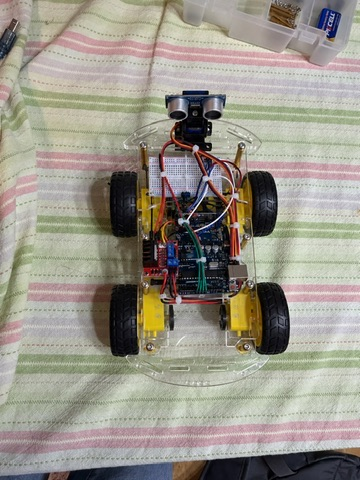
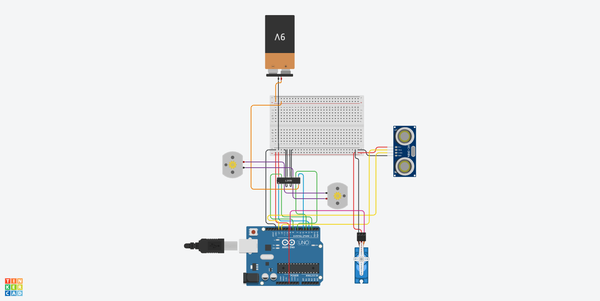

# Autonomous Obstacle-Avoiding Robot Car

A four-wheel-drive robot car that detects and avoids obstacles without human control. An ultrasonic sensor mounted on a servo scans the environment, an Arduino decides where to go, and an L298N motor driver steers the car using skid-steer (tank-style) drive.



## How It Works

The car runs a continuous **sense → decide → act** loop:

1. **Sense:** The HC-SR04 measures the distance ahead by timing an ultrasonic echo.
2. **Decide:** If the path is clear, the car keeps driving forward. If an obstacle is too close, it stops, and the SG90 servo rotates the sensor to measure the distance to the left and to the right.
3. **Act:** The car turns toward the more open direction and continues.

Turning is done by driving the left and right motor pairs at different speeds or in opposite directions, since the wheels are fixed.

## Hardware

| Component | Role |
|---|---|
| Arduino UNO R3 (ELEGOO) | Controller; runs the firmware |
| HC-SR04 ultrasonic sensor | Measures distance to obstacles |
| SG90 micro servo | Rotates the sensor to scan left, center, and right |
| L298N dual H-bridge driver | Drives the motors and sets direction and speed |
| 4x TT DC gearmotors + wheels | Skid-steer drive (two motors per side) |
| 4x AA battery pack | Power supply |
| 2-layer acrylic chassis | Mechanical frame |

## Pin Map

| Arduino Pin | Connection |
|---|---|
| D2 | L298N IN1 |
| D3 (PWM) | L298N ENA (left speed) |
| D4 | L298N IN2 |
| D5 (PWM) | L298N ENB (right speed) |
| D7 | L298N IN3 |
| D8 | L298N IN4 |
| D9 (PWM) | Servo signal |
| D12 | HC-SR04 Trig |
| D13 | HC-SR04 Echo |

All modules share a common ground.

## Circuit Simulation

The circuit and logic were first prototyped in Tinkercad before the physical build.



**Note:** The simulation uses an L293D driver, two motors, and a 9 V battery because Tinkercad does not include the L298N module. The physical car uses an L298N with four motors and a 4x AA pack, since a 9 V battery cannot supply enough current for four motors.

## Documentation

A full component analysis covering the H-bridge, PWM, servo feedback control, ultrasonic ranging, and power design (including brownout causes and mitigation) is available in [docs/autonomous_car.pdf](docs/autonomous_car.pdf).

## Repository Structure

```
├── src/       Arduino firmware
├── docs/      Component analysis (PDF)
└── images/    Photos and circuit diagram
```

## Team

- **Lianet Martin:** hardware assembly, wiring, and documentation
- **Nicole Laesker:** firmware, wiring, hardware assembly 

## License

MIT
